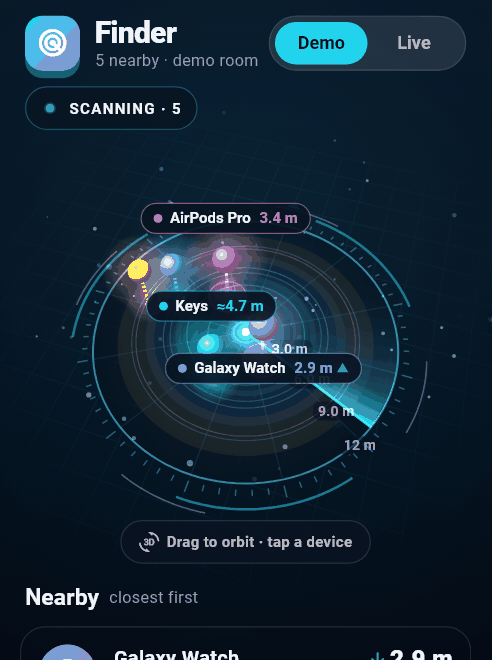
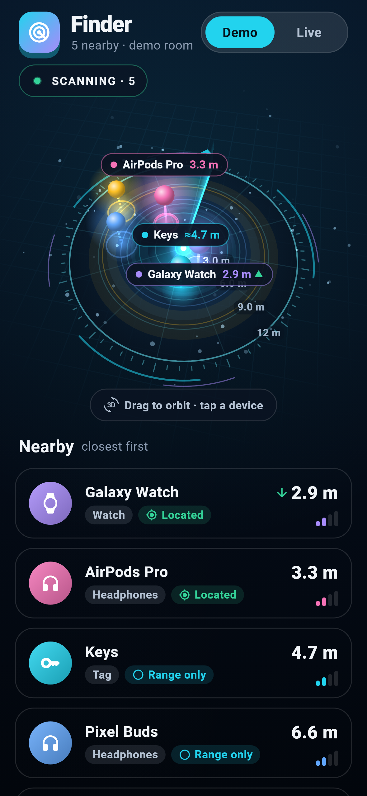
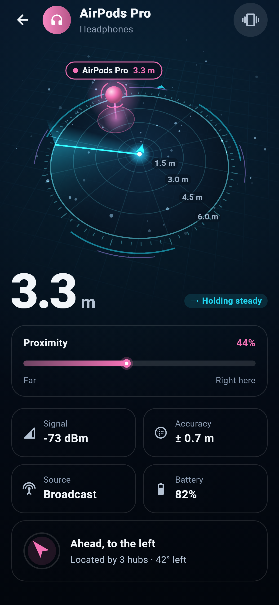
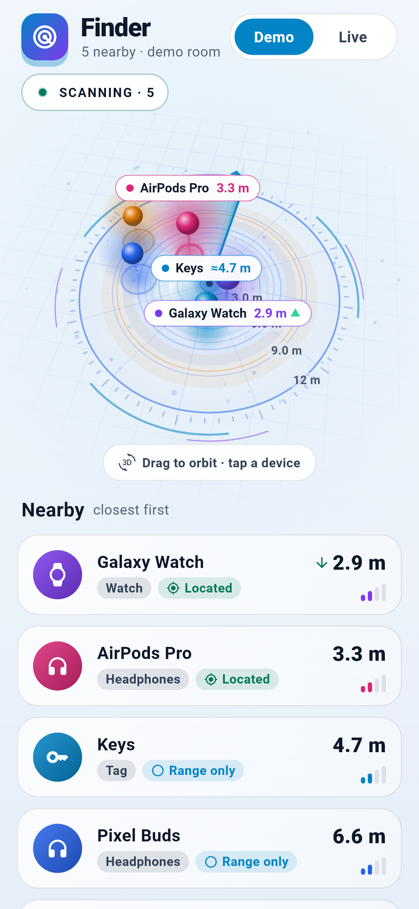
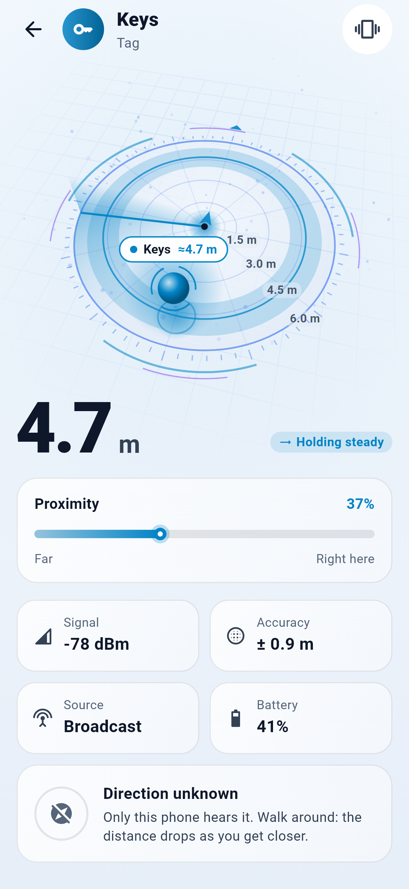

<div align="center">

# device_finder

**Fully offline Bluetooth device finding for Flutter — with a holographic 3D radar.**

A pure-Dart signal engine (Kalman-filtered RSSI, per-observer trilateration,
mirror-ambiguity resolution, calibration) and a 60 fps, orbitable 3D radar
widget. No cloud, no accounts, no network.

[](https://pub.dev/packages/device_finder)
[](https://pub.dev/packages/device_finder/score)
[](#platform-setup)
[](LICENSE)



</div>

<table>
  <tr>
    <td></td>
    <td></td>
    <td></td>
    <td></td>
  </tr>
</table>

> [!NOTE]
> Born from a personal need to find a lost phone when "Find My" was disabled.
> Inspired by [ben-z/findphone](https://github.com/ben-z/findphone) and
> [superfind](https://github.com/p4r1ch4y/superfind).

## Highlights

- **Holographic 3D radar (`Radar3DView`)** — a perspective disc you can drag
  to orbit (with inertia), double-tap to reset and tap to select. A volumetric
  sweep with a light curtain pings each device as it passes (orb flash +
  ground ripple). Devices are depth-sorted light pillars topped by glossy orbs
  with collision-free labels; range adapts smoothly; idles into a slow orbit.
- **Honest about direction** — with one phone you only know *distance*, so
  the device rides its range ring ("≈ 4.7 m"). With anchors, it sits at its
  trilaterated fix with a confidence ellipse on the floor. The engine never
  invents a bearing.
- **Reliable engine** — per-observer Kalman + source fusion, staleness instead
  of extrapolation, input sanitizing, ghost-free MAC-rotation grouping, live
  calibration profiles. 59 tests, including accuracy tests against simulated
  ground truth.
- **Accessible & cross-platform** — respects reduced motion, semantic
  summaries for screen readers, ≥ 4.5:1 text contrast, labels in the app's own
  font, platform-identical colors (exact 32-bit hashing, also on the web).
- **Zero-rebuild rendering** — painters bind to a `Listenable`; a bare
  `Ticker` drives animation without rebuilding widgets.

## Install

```yaml
dependencies:
  device_finder: ^0.2.0
  device_finder_ble: ^0.1.0 # optional: BLE capture via flutter_blue_plus
```

## Quick start

```dart
final tracker = DeviceTracker();

// Feed any RssiSample stream (device_finder_ble, your own driver, a replay…).
tracker.setInfo(DeviceInfo(id: 'AA:BB', name: 'Keys', kind: 'tag'));
tracker.pushSample(RssiSample(
  deviceId: 'AA:BB',
  source: RssiSource.advertising,
  dbm: -67,
  at: DateTime.now(),
));
tracker.tick(); // call every ~100 ms

// Draw it:
ListenableBuilder(
  listenable: tracker.stateNotifier.toFlutter,
  builder: (context, _) => Radar3DView(
    targets: RadarTarget.fromStates(tracker.states),
    onTargetTap: (id) => debugPrint('tapped $id'),
  ),
);
```

### Real positions with anchors

Give the tracker fixed observers (hubs, other phones, ESP32s). Each anchor's
`id` must match the `observerId` of the samples it hears; every observer gets
its own filter chain.

```dart
final tracker = DeviceTracker(
  anchorsProvider: () => [
    AnchorPoint(id: 'hub-a', x: -4.5, y: -2.5),
    AnchorPoint(id: 'hub-b', x: 4.5, y: -2.5),
    AnchorPoint(id: 'hub-c', x: 0.5, y: 6.0),
  ],
);

tracker.pushSample(RssiSample(
  deviceId: 'AA:BB',
  observerId: 'hub-a', // heard by hub A
  source: RssiSource.advertising,
  dbm: -71,
  at: DateTime.now(),
));
```

| Fresh anchors hearing the device | Result |
| :-- | :-- |
| 0–1 | Distance only (`fix == null`) |
| 2 | Closed-form pair + movement-history mirror resolution |
| ≥ 3 | Weighted Gauss–Newton / Levenberg–Marquardt with covariance |

When anchors go quiet the last fix is kept but marked `FixStatus.stale`.

### Radar options

```dart
Radar3DView(
  targets: targets,
  selectedId: selected,             // bigger orb, spinning ring, always labelled
  theme: const Radar3DTheme.light(),// or .dark(), or your own palette
  paintBackground: false,           // float on your app's background
  rangeMeters: 10,                  // fixed range (default: adaptive)
  initialPitchDegrees: 55,          // camera tilt, 20–89°
  autoOrbit: true,
  sweepPeriod: const Duration(milliseconds: 3200),
);
```

The 2D `RadarView`, `MultiRadarView`, `EllipseMap`, `SignalMeter` and
`DeviceList` widgets are still available.

### Calibration & haptics

```dart
final cal = Calibrator();
// cal.addSample(knownDistanceMeters, rssi) at 1, 2, 4 and 8 m …
final result = cal.fit();
if (result.accepted) tracker.applyProfile(deviceId, result.profile);

final haptics = GeigerHaptics()..start();
haptics.update(estimate.meters); // ticks speed up as you get closer;
haptics.stop();                  // silent immediately (and after 3 s of no data)
```

## How it works

```
RssiSample ─┬─ observer "self" ─▶ SourceFusion ─▶ Kalman ─▶ path loss ─▶ DistanceEstimate
            ├─ observer "hub-a" ▶ SourceFusion ─▶ Kalman ─▶ path loss ─┐
            ├─ observer "hub-b" ▶ …                                    ├─▶ trilateration ─▶ PositionFix
            └─ observer "hub-c" ▶ …                                    ┘   (+ mirror resolver)
```

- **Kalman (dB domain)** — `[rssi, velocity]` state, adaptive step boost,
  duplicate/out-of-order samples ignored.
- **Source fusion** — the cleanest window wins (connected link preferred);
  silence becomes *stale*, then *ghost*, never an extrapolated position.
- **Path loss** — `d = 10^((Tx − RSSI) / (10·n))`, priors −59 dBm / n = 2.8,
  advertised TxPower used when available.

## Platform setup

| Platform | Engine & radar | BLE (via `device_finder_ble`) |
| :-- | :-- | :-- |
| Android | ✅ | Manifest permissions below |
| iOS | ✅ | `NSBluetoothAlwaysUsageDescription` |
| macOS | ✅ | Usage string **and** `com.apple.security.device.bluetooth` entitlement |
| Windows / Linux | ✅ | Supported by flutter_blue_plus |
| Web | ✅ | Browser Web Bluetooth (limited); use `MemoryProfileStore` |

<details>
<summary><b>Android</b> — <code>AndroidManifest.xml</code></summary>

```xml
<uses-permission android:name="android.permission.BLUETOOTH" android:maxSdkVersion="30" />
<uses-permission android:name="android.permission.BLUETOOTH_ADMIN" android:maxSdkVersion="30" />
<uses-permission android:name="android.permission.ACCESS_FINE_LOCATION" android:maxSdkVersion="30" />
<uses-permission android:name="android.permission.BLUETOOTH_SCAN" android:usesPermissionFlags="neverForLocation" />
<uses-permission android:name="android.permission.BLUETOOTH_CONNECT" />
<uses-feature android:name="android.hardware.bluetooth_le" android:required="false" />
```
</details>

<details>
<summary><b>iOS</b> — <code>Info.plist</code></summary>

```xml
<key>NSBluetoothAlwaysUsageDescription</key>
<string>Finds your devices by Bluetooth signal strength.</string>
<!-- optional, for background scanning -->
<key>UIBackgroundModes</key>
<array><string>bluetooth-central</string></array>
```
</details>

<details>
<summary><b>macOS</b> — <code>Info.plist</code> + both <code>*.entitlements</code></summary>

```xml
<!-- Info.plist -->
<key>NSBluetoothAlwaysUsageDescription</key>
<string>Finds your devices by Bluetooth signal strength.</string>

<!-- DebugProfile.entitlements and Release.entitlements -->
<key>com.apple.security.device.bluetooth</key>
<true/>
```
Without both, macOS blocks Bluetooth and terminates the app on first use.
</details>

## Example app

[`example/`](example) is a complete "Finder" app: a demo room with three hubs
(no Bluetooth needed — some devices trilaterated, some distance-only, one that
drops out) and a **Live** mode that scans real devices.

```bash
cd example
flutter run
```

Screenshots are rendered from the real app with real fonts:
`flutter test test/screenshots_test.dart --dart-define=CAPTURE=true`.

## Upgrading from 0.1.x

- Samples are now filtered **per `observerId`**. With anchors, set each
  sample's `observerId` to the anchor's `id` — previously every anchor was
  given the same single-phone distance, which produced meaningless fixes.
- One anchor (or samples only from `'self'`) now means distance-only
  (`fix == null`) instead of a made-up position "to the east".
- `GeigerHaptics.start()` takes an optional interval function, and `stop()`
  really stops (it used to keep ticking on the last distance).
- Minimum Flutter 3.29 / Dart 3.7.

## Contributing

Issues and PRs welcome. `flutter analyze` and `flutter test` (package and
`example/`) must pass.

## License

MIT — see [LICENSE](LICENSE).
