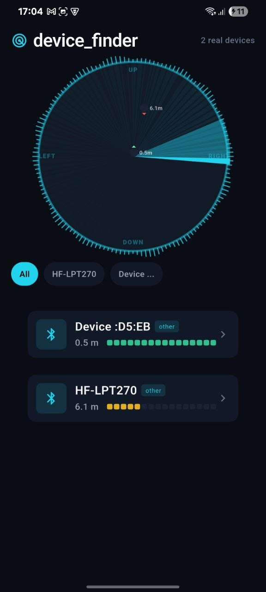

# device_finder



Fully offline Bluetooth device tracking for Flutter. A pure-Dart, Kalman-filtered
RSSI engine, trilateration with mirror-ambiguity resolution, offline calibration
profiles, and a premium radar UI.

Inspired by [findphone](https://github.com/ben-z/findphone) and
[superfind](https://github.com/p4r1ch4y/superfind).

> [!NOTE]
> This project was born from a personal need to find a lost phone when "Find My" was disabled. 
> Inspired by the idea that you can just build the tools you need. 
> Special thanks to [ben-z/findphone](https://github.com/ben-z/findphone) for the original inspiration.

## Features

- **Pure-Dart signal engine** — Kalman filter (dB domain), source fusion
  (connected-link vs advertising), log-distance path loss
  (`d = 10^((Tx−RSSI)/(10n))`), Gauss–Newton trilateration with
  Levenberg–Marquardt damping, and geometric mirror-ambiguity resolution via
  movement history.
- **Zero-latency UI** — `CustomPainter` with `repaint:` Listenable wiring and a
  bare `Ticker`: live BLE data mutates the scene, never rebuilds the widget
  tree. 60fps sweeping radar with lit sectors, 95% confidence ellipse map,
  signal meter, and a device list grouped by broadcast name.
- **Offline calibration profiles** — guided 1-2-4-8 m routine with
  physically-plausible fit rejection (residual > 8 dB, implausible exponent).
  Profiles persist locally and load instantly on device detection.
- **Hardware-aware** — prefers connected-link RSSI (cleaner, σ≈4 dB), uses
  advertised TxPower (AD 0x0A) as a free calibration reference, and falls back
  to −59 dBm / n=2.8 priors.
- **Geiger haptics** — accelerating ticks as the target nears, for eyes-free
  searching.

## Getting started

```yaml
dependencies:
  device_finder: ^0.1.0
```

```dart
final tracker = DeviceTracker();

// Feed the engine any RssiSample stream:
tracker.pushSample(RssiSample(
  deviceId: 'my-device-id',
  source: RssiSource.advertising,
  dbm: -65.0,
  at: DateTime.now(),
));

// Bind the UI:
RadarView(
  estimate: tracker.stateOf(id)?.estimate,
  fix: tracker.stateOf(id)?.fix,
);
```

The engine is driver-agnostic: feed it any `RssiSample` stream.

### Permissions

**Android**

```xml
<uses-permission android:name="android.permission.BLUETOOTH"
    android:maxSdkVersion="30" />
<uses-permission android:name="android.permission.BLUETOOTH_ADMIN"
    android:maxSdkVersion="30" />
<uses-permission android:name="android.permission.ACCESS_FINE_LOCATION"
    android:maxSdkVersion="30" />
<uses-permission android:name="android.permission.BLUETOOTH_SCAN"
    android:usesPermissionFlags="neverForLocation" />
<uses-permission android:name="android.permission.BLUETOOTH_CONNECT" />
```

**iOS**

`NSBluetoothAlwaysUsageDescription` in Info.plist; add `bluetooth-central` to
`UIBackgroundModes` for background scanning.

## Calibration

Run the guided 1-2-4-8 m routine to fit device-specific (TxPower, n). Fits are
rejected when the residual exceeds 8 dB or the parameters are physically
implausible.

## Contributing

Contributions welcome. `flutter test` must pass before merging.

## License

MIT — see [LICENSE](LICENSE).
